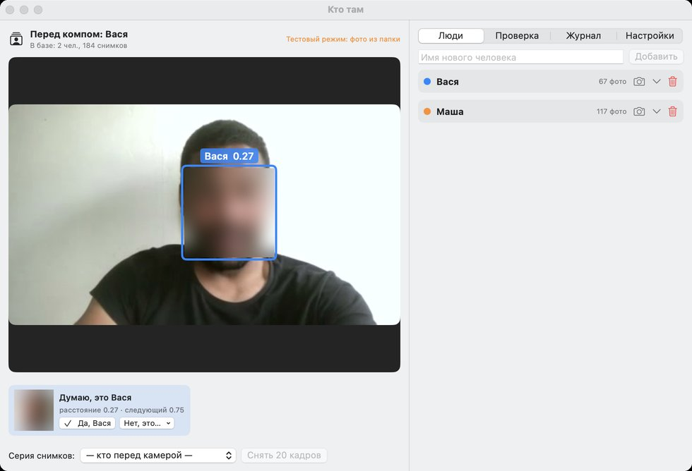

# Кто там

Программа узнаёт, кто сидит перед компьютером, и здоровается синтетическим голосом:
«Привет, Имя!» — когда человек появился в кадре, «Пока, Имя!» — когда ушёл.
Обучается в простом интерфейсе: «программа думала, что это Вася» → «нет, это Маша» — снимок уходит в базу.



Две версии с одинаковым интерфейсом и логикой:

| | macOS | Windows |
|---|---|---|
| Папка | [`macos/`](macos) | [`windows/`](windows) |
| Язык | Swift + SwiftUI | Python + Tk (собирается в .exe) |
| Поиск лица | Apple Vision | OpenCV YuNet |
| Распознавание | SFace (Core ML, нейроядро Apple Silicon) | SFace (OpenCV) |
| Голос | AVSpeechSynthesizer (Milena) | Голоса Windows (SAPI) |
| Камера | встроенная / USB / Continuity | встроенная / USB / IP-камера `rtsp://…` |
| База | `~/Library/Application Support/Ktotam/faces.sqlite` | `%APPDATA%\Ktotam\faces.sqlite` |

## Скачать

Готовые сборки — на странице [Releases](../../releases/latest):

- **ade_ktotam-macos.zip** — распаковать и перенести в «Программы». Сборка не подписана: при первом запуске
  правый клик → «Открыть» (или `xattr -dr com.apple.quarantine ade_ktotam.app`). Нужен macOS 15+, Apple Silicon.
- **ktotam-windows.zip** — распаковать в любую папку и запустить `ktotam.exe`. Windows 10/11, 64-бит.
  Русский голос: «Параметры → Время и язык → Речь → Добавить голоса → Русский».

## Как пользоваться

1. «Люди» → ввести имя → «Добавить».
2. Под камерой: «Серия снимков» → выбрать человека → «Снять 20 кадров» (смотреть в камеру и крутить головой).
3. Дальше — поправками. У каждого лица в кадре кнопки «✓ Да, Вася» и «Нет, это… → Маша / Новый человек».
   Вкладка «Проверка» — лента «что думала программа»: там же подтверждать и поправлять.
   Поправка закрепляет имя за лицом, пока оно в кадре, и добирает ещё 6 его снимков к правильному человеку.
4. «Настройки»: порог узнавания, через сколько секунд говорить «Пока», голос, камера.

## Связь с Битрикс24

Вкладка «Б24»: вписать адрес портала → «Подключить» → в браузере открывается страница портала с кодом,
сотрудник нажимает «Разрешить», и приложение привязывается к его учётке. Дальше там же — «Кто есть кто»:
каждому человеку из базы выбрать сотрудника портала.

- Портал узнаёт, кто из сотрудников перед экраном: приложение шлёт «появился / ушёл» и раз в 30 с — пульс.
  Уходят только id сотрудника и время; снимки и векторы лиц остаются на компьютере.
- С портала приходят голосовые сообщения — приложение проговаривает их своим голосом (речь синтезируется локально).
  Режимы: «сразу», «когда появится перед экраном» (накопленное звучит одним сообщением), «только если сейчас перед экраном».
- Серверная часть (страницы `/ade/claude/ktotam/`) — в коробке Битрикс24 и в этот репозиторий не входит.
  API: `pair_start`, `pair_poll`, `people`, `sync`, `event`, `status`, `pull` (long-poll), `ack`, `unpair`;
  заголовки `X-Ktotam-Device` и `X-Ktotam-Token`.

## Как устроено

Камера → поиск лиц → выравнивание по глазам → вектор лица → сравнение с базой ближайшими соседями
(среднее 3 ближайших снимков человека) → трекер ведёт лицо между кадрами, имя решает большинство из 8 кадров →
приветствие при появлении, прощание после паузы. Снимки лиц хранятся в SQLite вместе с векторами
и никуда не отправляются.

## Точность

Проверка на 13 людях из стоковых видеозвонков (кадры 426×240): учим на одном ролике человека,
узнаём на другом (другой день, свет, одежда).

| | по одному кадру | с голосованием трека | чужого принимает за своего |
|---|---|---|---|
| macOS (SFace, порог 0.95) | 99,9% | 100% | 0% |
| Windows (SFace, порог 0.95) | 99,9% | 100% | 0% |

В обеих версиях одна и та же модель лиц — SFace. До версии 1.1 мак-версия распознавала через Vision FeaturePrint
(98% и ~8% ложных узнаваний незнакомцев); база при обновлении переводится сама, переобучать людей не нужно.

## Сборка и тесты

macOS (нужны только Command Line Tools):
```
cd macos && ./build.sh                 # → ~/Applications/ade_ktotam.app
build/Ktotam --selftest [папка]        # папка: человек/ролик/кадры
```

Windows (или для разработки на любой системе):
```
cd windows
pip install -r requirements.txt
python main.py                         # запуск
python main.py --selftest [папка]      # тесты
```
`.exe` собирает GitHub Actions ([workflow](.github/workflows/windows.yml)): тесты, PyInstaller,
проверка собранного `ktotam.exe` и снимок окна. Ключи запуска одинаковые в обеих версиях:
`--import <папка Имя/фото>`, `--db`, `--fake-camera <папка>`, `--mute`, `--test-fix <имя>`, `--snapshot <png> <сек>`, `--tab <номер>`.

## Важно

Снимки лиц — биометрические персональные данные. Если ставите программу не только для себя
(например, в офисе), нужно письменное согласие людей, которых она узнаёт.

Модели YuNet (MIT) и SFace (Apache 2.0) — из [OpenCV Zoo](https://github.com/opencv/opencv_zoo); для macOS SFace переведена в Core ML (`macos/models/SFace.mlmodelc`).
Код — MIT.
